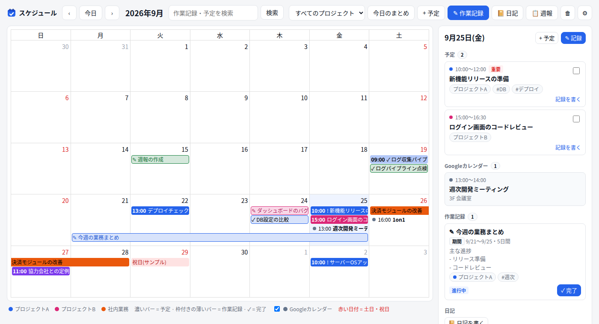
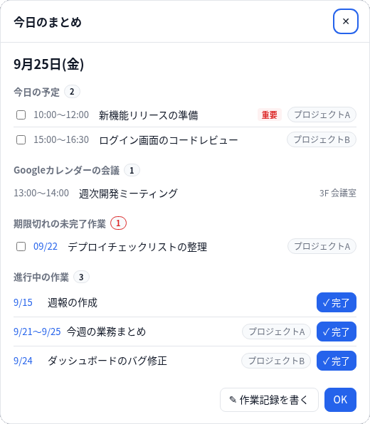
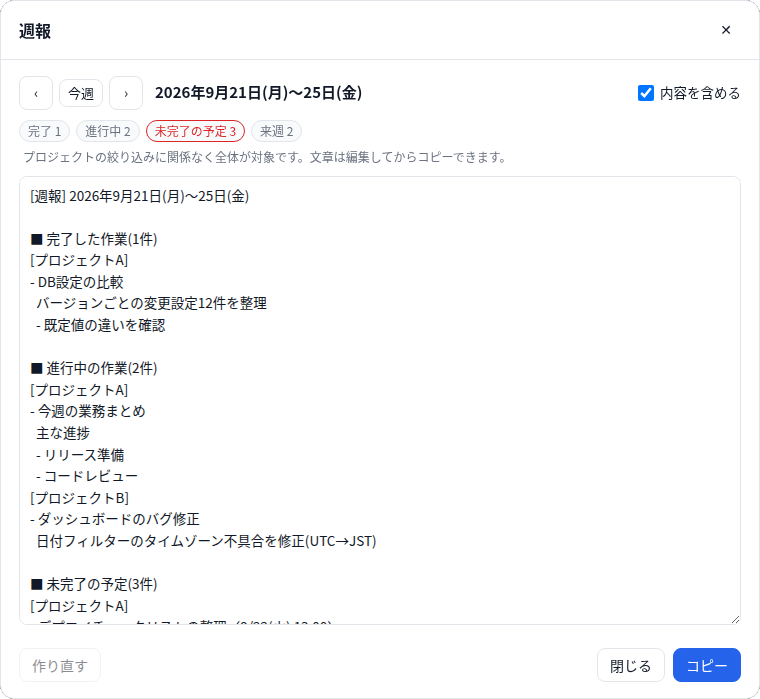
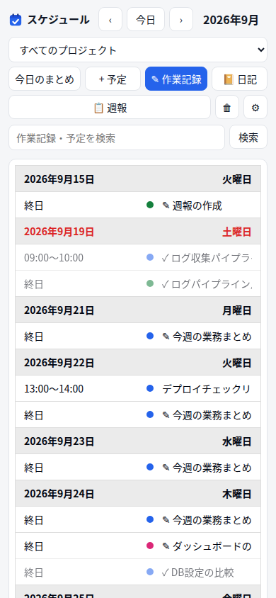

# スケジュール管理(個人用の予定・作業記録アプリ)

予定・作業記録・日記をひとつの画面で管理する**個人用**アプリです。サーバーやソフトのインストールは不要で、**各自が自分の Google アカウントにインストールして、ひとりで使います。**

メイン画面 — 左は月のカレンダー、右は選んだ日の予定・作業記録・日記。画面のデータはサンプルです。

## 📘 マニュアル(PDF)

**インストールの詳しい手順(画面付き)、更新、アンインストール、困ったときの対処は、マニュアルをご覧ください。**

| 言語 | ファイル |
|---|---|
| 日本語 | [schedule-app-manual-ja.pdf](https://github.com/user-attachments/files/33696139/schedule-app-manual-ja.pdf) |
| 한국어(韓国語) | [schedule-app-manual-ko.pdf](https://github.com/user-attachments/files/33696136/schedule-app-manual-ko.pdf) |

---

## 画面の紹介

| 今日のまとめ(その日最初に開いたとき) | 週報(文章を作ってコピー) | スマートフォン |
|:---:|:---:|:---:|
|  |  |  |

| 機能 | 内容 |
|---|---|
| 月のカレンダー | 予定・作業記録・Googleカレンダーの会議(読み取りのみ)・日本の祝日をひとつの画面に表示。予定はプロジェクト色の濃いバー、作業記録は枠付きの薄いバー、完了(✓)は薄いバーに黒い文字。土日・祝日は赤い日付 |
| 日付パネル(右側) | 日付を押すと、その日の予定・会議・作業記録・日記を一覧。チェックで予定を完了に |
| 予定 | 作業/会議、終日・時刻、優先度、プロジェクト、タグ、場所・会議リンク |
| 作業記録 | 1日の記録と期間の記録(最大92日)。進行中 → 完了 |
| 日記 | 1日1件。「📔 日記」で週ごとに表示・検索 |
| 週報 | 「📋 週報」で1週間の作業をプロジェクト別にまとめた文章を作ってコピー。「内容を含める」で作業記録の内容も入ります |
| 検索 | キーワード・プロジェクト・期間で作業記録と予定を検索 |
| 朝の通知 | その日最初に開くと「今日のまとめ」を表示。平日の朝にまとめメール(既定は7〜8時、土日・祝日は休み) |
| ゴミ箱 | 削除直後の「元に戻す」(10秒)、「🗑」から30日以内に削除したものを復元 |
| バックアップ | 毎週月曜にスプレッドシートをドライブへコピー(最新8件を保管) |
| 言語 | 日本語・韓国語。「⚙ 設定」→「一般」→「言語」 |

- データは自分の Google ドライブのスプレッドシート「스케줄관리 DB」だけに保存されます。コードを渡した人を含め、ほかの人は見られません。
- 日本時間(UTC+9)と日本の祝日が基準です。

---

## かんたんインストール(ブラウザだけ・約15分)

PC の Chrome で、アプリを使う Google アカウントにログインして進めます。**画面付きの詳しい手順はマニュアルの「2. インストール」をご覧ください。**

> 💡 Chrome に複数の Google アカウントでログインしていると、別のアカウントにインストールされることがあります。使うアカウントだけでログインした Chrome プロファイルで行うと安全です。

### 1. ファイルを受け取る

1. GitHub の招待メールで **Join** を押し、https://github.com/biyanet-ap/schedule-app/releases を開きます
2. 最新バージョンの **Assets** から **`schedule-app.zip`** をダウンロードして展開します(「Source code」ではありません)
3. `apps-script` フォルダに `appsscript.json`・`Code.gs`・`index.html` の3つがあれば準備完了です

### 2. プロジェクトを作ってファイルを入れる

1. Chrome で **https://script.new** を開き、左上の「無題のプロジェクト」を「スケジュール管理」に変えます
2. 左の ⚙「プロジェクトの設定」→「"appsscript.json" マニフェスト ファイルをエディタで表示する」にチェックし、左の `< >`(エディタ)に戻ります
3. 「ファイル」横の **＋ → HTML** を押し、名前に **`index`** だけを入力します
    - ⚠️ `index.html` まで入力すると一覧に `index.html.html` と表示され、ウェブアプリが開きません
4. 3つのファイルの中身を、受け取ったファイルの内容ですべて置き換えて **Ctrl+S** で保存します

| エディタのファイル | 貼り付ける内容 |
|---|---|
| `appsscript.json` | `apps-script/appsscript.json` |
| `Code.gs` | `apps-script/Code.gs` |
| `index.html` | `apps-script/index.html`(約500KB。貼り付けに数秒かかります) |

受け取ったファイルをメモ帳で開いて **Ctrl+A → Ctrl+C**、エディタで同じ名前のファイルを開いて **Ctrl+A → Ctrl+V** です。

### 3. setup を実行して権限を承認

1. 上の関数名(▾)を押し、一覧のいちばん下にある **`setup`** を選んで **▷ 実行** を押します
2. 「権限を確認」→ アカウントを選択 →「確認されていないアプリ」と表示されたら「詳細」→「スケジュール管理（安全ではないページ）に移動」
    - 自分で作ったスクリプトなので表示される案内です
3. 権限の一覧にチェックボックスがあれば **すべて選択** してから「続行(許可)」を押します
4. 実行ログが `[OK]` なら成功です。続けて **`runSelfTest`** も同じ方法で実行し、すべての行が `[OK]` か確認します

### 4. ウェブアプリとしてデプロイ

1. 右上の「デプロイ」→「新しいデプロイ」→ 種類の選択 ⚙ →「ウェブアプリ」
2. 「次のユーザーとして実行」は **自分**、「アクセスできるユーザー」は **自分のみ**(⚠️ 必ず確認)にして「デプロイ」
3. 表示されたウェブアプリの URL を Chrome のブックマークに登録します。スマートフォンでも同じ URL で開きます

✅ アプリの画面が開けば、インストールは完了です。

| こんなとき | すること |
|---|---|
| runSelfTest の祝日の行が `[WARN]` | Googleカレンダーに「日本の祝日」(英語の画面では「Holidays in Japan」)を追加して、setup をもう一度実行 |
| 画面上部に「このアプリケーションは Google Apps Script のユーザーによって作成されました」 | 自分でインストールしたアプリに Google が付ける案内です。そのまま使えます |
| ウェブアプリが開かない | エディタの一覧に `index.html.html` と表示されていたら、名前を `index` に変更 → 保存 →「デプロイを管理」で新しいバージョンをデプロイ |
| そのほか | マニュアルの「困ったときは」をご覧ください。問い合わせるときは、エラーの内容や runSelfTest の結果を添えてください |

---

## 更新・アンインストール・開発者向け

| 内容 | マニュアルの該当ページ |
|---|---|
| 新しいバージョンへの更新(データと URL はそのまま) | 「2. インストール」→「更新ファイルを受け取ったとき」 |
| アンインストール(データの削除) | 「4. 運用とトラブル対応」→「アプリの利用をやめるとき」 |
| 開発者向けインストール(Node.js + clasp)・更新・ロールバック | 「付録A」「付録B」 |
| 設定値(settings シート) | 「付録C」 |

新しいバージョンのお知らせを受け取るには、リポジトリ右上の **Watch → Custom → Releases** にチェックします。
